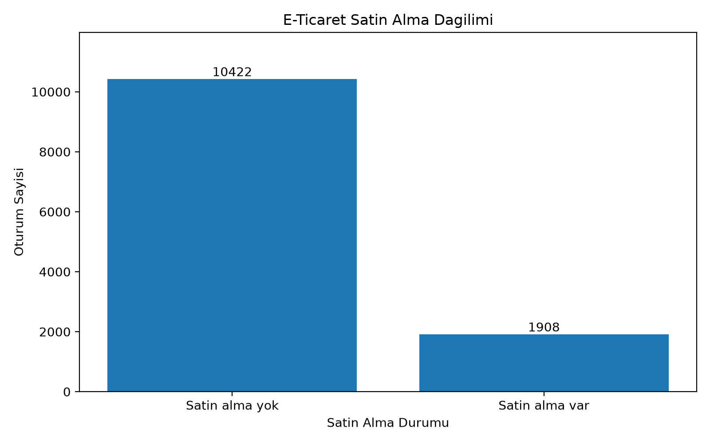
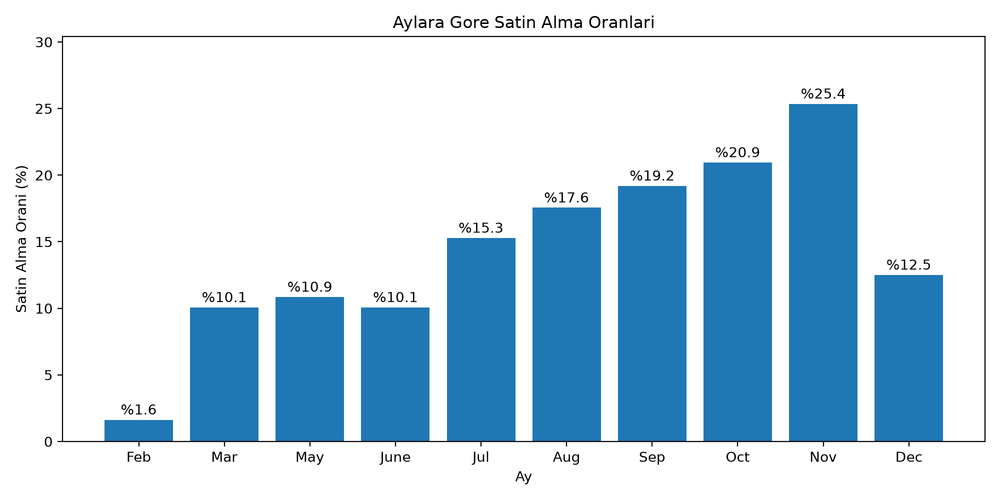
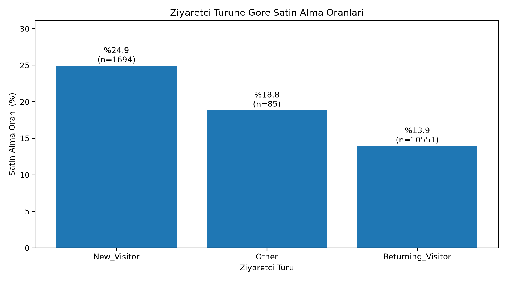
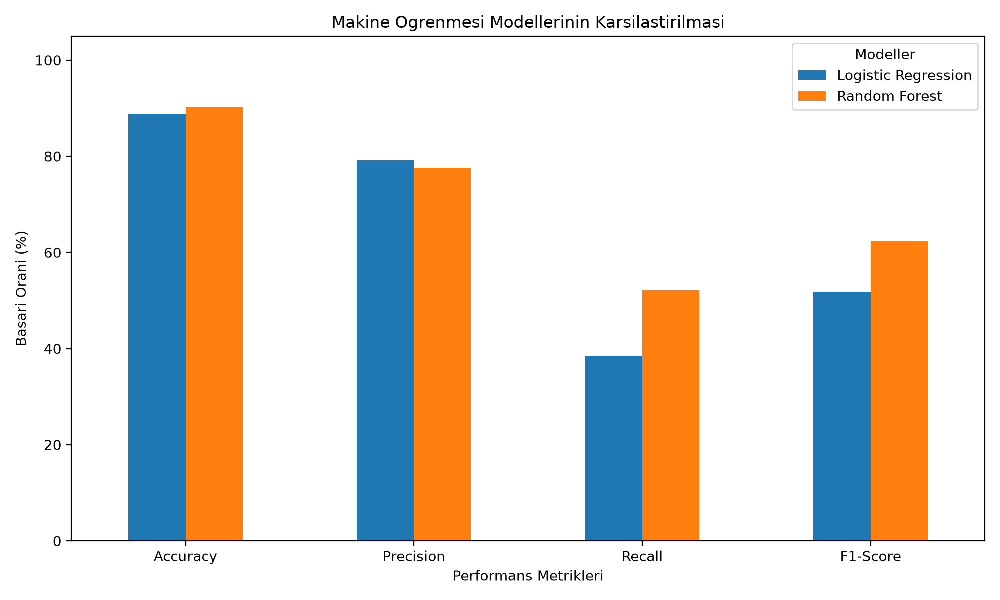
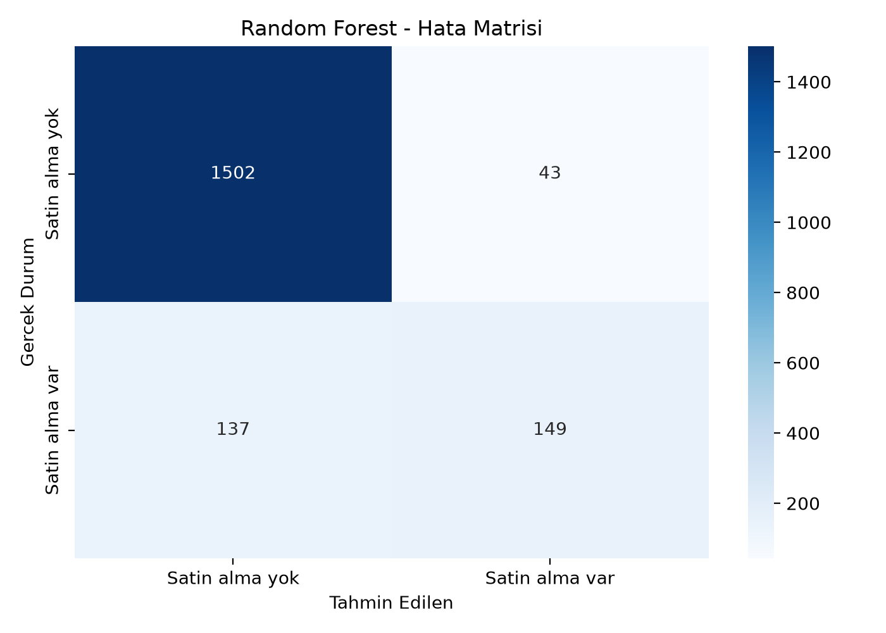

# ShopPredict AI

### Makine Öğrenmesi ile E-Ticaret Satın Alma Davranışının Tahmini

**ShopPredict AI**, bir e-ticaret sitesindeki ziyaretçi oturumunun satın alma ile sonuçlanıp sonuçlanmadığını sınıflandırmak için geliştirilmiş, Python tabanlı bir makine öğrenmesi çalışmasıdır. Proje; veri setinin incelenmesini, keşifsel veri analizini (EDA), veri temizlemeyi, ön işlemeyi, iki farklı sınıflandırma algoritmasının eğitilmesini, performans karşılaştırmasını ve hata analizini kapsar.

Bu çalışma, **Çağatay Nail Şengör – Makine ve Derin Öğrenme Uygulamaları (2. hafta)** proje yönergesi kapsamında hazırlanmıştır. Bir web uygulaması veya canlı tahmin servisi değil; tekrarlanabilir bir veri bilimi ve model değerlendirme projesidir.

> **Kapsam notu:** Çalışmadaki ana tahminler, veri setindeki tamamlanmış oturumlara ait özelliklerle elde edilmiştir. Sonuçlar, alışveriş tamamlanmadan önce çalışan bir gerçek zamanlı sistemin başarısı olarak yorumlanmamalıdır.

## İçindekiler

1. [Problem ve amaç](#1-problem-ve-amaç)
2. [Veri seti ve değişkenler](#2-veri-seti-ve-değişkenler)
3. [Keşifsel veri analizi](#3-keşifsel-veri-analizi)
4. [Veri temizleme ve ön işleme](#4-veri-temizleme-ve-ön-işleme)
5. [Modelleme yaklaşımı](#5-modelleme-yaklaşımı)
6. [Doğrulama sonuçları](#6-doğrulama-sonuçları)
7. [Hata analizi](#7-hata-analizi)
8. [PageValues deneyleri ve karar eşiği](#8-pagevalues-deneyleri-ve-karar-eşiği)
9. [Nihai test sonuçları](#9-nihai-test-sonuçları)
10. [Kurulum ve çalıştırma](#10-kurulum-ve-çalıştırma)
11. [Proje yapısı](#11-proje-yapısı)
12. [Sınırlamalar ve geliştirme önerileri](#12-sınırlamalar-ve-geliştirme-önerileri)
13. [Kaynaklar](#13-kaynaklar)

---

## 1. Problem ve amaç

E-ticaret platformlarında her ziyaretçi oturumu satın alma ile sonuçlanmaz. Ziyaretçilerin görüntüledikleri sayfalar, sayfalarda geçirdikleri süreler, trafik kaynakları ve diğer oturum özellikleri satın alma davranışıyla ilişkili olabilir. Bu projenin amacı, bu özellikleri kullanarak **bir oturumun satın alma ile sonuçlanıp sonuçlanmadığını** tahmin etmek ve hangi durumlarda modelin hata yaptığını incelemektir.

Araştırma soruları:

- Oturum bilgileri kullanılarak satın alma durumu tahmin edilebilir mi?
- Logistic Regression ve Random Forest modellerinin başarıları nasıl farklılaşır?
- Sınıflar dengesiz olduğunda `accuracy` tek başına neden yeterli değildir?
- `PageValues` özelliğinin çıkarılması ve karar eşiğinin değiştirilmesi sonuçları nasıl etkiler?
- Model hangi gerçek satın alma oturumlarını kaçırmaktadır?

**Problem türü:** İkili sınıflandırma.

**Hedef değişken:** `Revenue` (`True`: satın alma gerçekleşmiş, `False`: satın alma gerçekleşmemiş).

## 2. Veri seti ve değişkenler

**Veri seti:** Online Shoppers Purchasing Intention Dataset  
**Yayıncı:** UCI Machine Learning Repository  
**Resmî bağlantı:** https://archive.ics.uci.edu/dataset/468/online+shoppers+purchasing+intention+dataset

| Özellik | Değer |
|---|---:|
| Orijinal oturum kaydı | 12.330 |
| Girdi değişkeni | 17 |
| Hedef değişken | 1 (`Revenue`) |
| Toplam sütun | 18 |
| Tespit edilen eksik değer | 0 |
| Birebir aynı özellik ve hedef değerlerine sahip fazladan satır | 125 |
| Tekilleştirmeden sonraki kayıt | 12.205 |

### 2.1. Değişken sözlüğü

| Değişken | Açıklama |
|---|---|
| `Administrative` | Ziyaret edilen yönetimsel sayfa sayısı |
| `Administrative_Duration` | Yönetimsel sayfalarda geçirilen süre |
| `Informational` | Ziyaret edilen bilgilendirme sayfası sayısı |
| `Informational_Duration` | Bilgilendirme sayfalarında geçirilen süre |
| `ProductRelated` | Görüntülenen ürünle ilgili sayfa sayısı |
| `ProductRelated_Duration` | Ürünle ilgili sayfalarda geçirilen süre |
| `BounceRates` | Hemen çıkma davranışıyla ilgili analitik oran |
| `ExitRates` | Çıkış davranışıyla ilgili analitik oran |
| `PageValues` | İşlem değeriyle ilişkili sayfa analitiği ölçümü |
| `SpecialDay` | Belirli özel günlere yakınlığı ifade eden ölçüm |
| `Month` | Oturumun gerçekleştiği ay |
| `OperatingSystems` | İşletim sistemi kategori kodu |
| `Browser` | Tarayıcı kategori kodu |
| `Region` | Bölge kategori kodu |
| `TrafficType` | Trafik kaynağı/türü kategori kodu |
| `VisitorType` | Yeni, tekrar gelen veya diğer ziyaretçi türü |
| `Weekend` | Oturumun hafta sonuna denk gelip gelmediği |
| `Revenue` | **Hedef:** Oturum satın almayla sonuçlandı mı? |

**Önemli:** `OperatingSystems`, `Browser`, `Region` ve `TrafficType` sayısal görünse de kategorileri temsil eder; dolayısıyla doğrudan sürekli sayısal büyüklük gibi değerlendirilmemiştir.

### 2.2. Sınıf dağılımı — orijinal veri

| Sınıf | Oturum sayısı | Oran |
|---|---:|---:|
| Satın alma yok (`False`) | 10.422 | %84,53 |
| Satın alma var (`True`) | 1.908 | %15,47 |
| **Toplam** | **12.330** | **%100** |

Pozitif sınıfın azınlıkta olması nedeniyle tek başına doğruluk oranına değil; **precision, recall, F1-score** ve hata matrisine de bakılmıştır.

## 3. Keşifsel veri analizi

İlk üç grafik, **orijinal 12.330 kayıt** üzerinden hazırlanmıştır. Aşağıdaki görseller `veri_analizi.py` çalıştırıldığında `grafikler/` klasörüne kaydedilir.

### 3.1. Satın alma dağılımı



Verilerin çoğu satın alma gerçekleşmeyen oturumlardan oluşmaktadır. Bu dengesizlik, pozitif sınıfı hiç tahmin etmeyen bir modelin dahi yüksek doğruluk gösterebilmesine yol açabilir.

### 3.2. Aylara göre satın alma oranları



Veri setinde **Kasım ayında %25,4** ile en yüksek, **Şubat ayında %1,6** ile en düşük satın alma oranı gözlenmiştir. Bunlar her ayın kendi oturumları içindeki oranlardır; aylara göre toplam satış adetleri değildir. Veri setinde Ocak ve Nisan aylarına ait kayıt bulunmamaktadır. Farklılıklar tek başına mevsimsel nedenselliği kanıtlamaz; aylık örneklem büyüklükleri de dikkate alınmalıdır.

### 3.3. Ziyaretçi türüne göre satın alma oranları



| Ziyaretçi türü | Oturum sayısı | Satın alma oranı |
|---|---:|---:|
| `New_Visitor` | 1.694 | %24,91 |
| `Returning_Visitor` | 10.551 | %13,93 |
| `Other` | 85 | %18,82 |

Yeni ziyaretçi oturumlarında satın alma oranı daha yüksek görünmektedir. `Other` grubunun yalnızca 85 oturum içermesi nedeniyle bu grubun oranı dikkatle yorumlanmalıdır. Bulgular ilişkiyi gösterir, neden-sonuç ilişkisini değil.

### 3.4. Sayısal değişkenlerden örnek bulgular

Orijinal veri üzerinden hesaplanan betimsel istatistiklere göre:

- `ProductRelated` ortalaması **31,73**, ortancası **18**, maksimum değeri **705**.
- `BounceRates` ortalaması yaklaşık **0,02**, `ExitRates` ortalaması yaklaşık **0,04**.
- `PageValues` ortalaması **5,89**, ortancası **0**, maksimum değeri **361,76**.

Özellikle `PageValues` dağılımının sağa çarpık olabileceği görülmektedir. Sadece yüksek değer içerdiği için kayıtlar otomatik olarak silinmemiştir.

## 4. Veri temizleme ve ön işleme

### 4.1. Eksik ve tekrarlanan değerler

- Her sütunda eksik değer sayısı **0** bulundu; eksik değer doldurma uygulanmadı.
- Tamamen aynı satırlardan **125 fazladan kayıt** `drop_duplicates()` ile çıkarıldı.
- Orijinal dosya korunarak `online_shoppers_clean.csv` oluşturuldu.

**Sınırlama:** Veri setinde benzersiz oturum kimliği bulunmadığından, birebir aynı özelliklere sahip iki satırın farklı gerçek oturumlar olma ihtimali dışlanamaz. Tekilleştirme bu varsayımla yapılmıştır.

### 4.2. Eğitim, doğrulama ve test ayrımı

Tekilleştirilmiş **12.205 kayıt** `stratify` ve `random_state=42` kullanılarak yaklaşık %70 / %15 / %15 oranında ayrılmıştır:

| Küme | Kayıt | Satın alma oranı |
|---|---:|---:|
| Eğitim | 8.543 | %15,64 |
| Doğrulama | 1.831 | %15,62 |
| Test | 1.831 | %15,62 |
| **Toplam** | **12.205** | — |

Doğrulama kümesi modelleri karşılaştırmak ve karar eşiğini seçmek için; test kümesi ise **seçimler tamamlandıktan sonra** nihai değerlendirme için kullanılmıştır.

### 4.3. Özellik dönüşümleri

- **10 sayısal sütun:** `StandardScaler` ile ölçeklendirildi.
- **7 kategorik sütun:** `OneHotEncoder(handle_unknown="ignore")` ile kodlandı.
- Dönüştürme sonunda girdi boyutu **74 özellik** oldu.
- `ColumnTransformer` yalnızca eğitim kümesinde `fit_transform`, doğrulama ve test kümelerinde `transform` ile kullanıldı.

Bu düzen, ölçekleme ve kodlama parametrelerinin doğrulama veya test kümesinden öğrenilmesini önler. Bununla birlikte özelliklerin tahmin anında erişilebilirliği ayrı bir konudur; özellikle `PageValues` için aşağıdaki sınırlamalar geçerlidir.

## 5. Modelleme yaklaşımı

İki temel sınıflandırıcı eğitildi:

| Model | Kullanılan önemli ayarlar | Amaç |
|---|---|---|
| `LogisticRegression` | `max_iter=1000`, `random_state=42` | Temel, yorumlanabilir karşılaştırma modeli |
| `RandomForestClassifier` | `n_estimators=200`, `min_samples_leaf=3`, `random_state=42`, `n_jobs=-1` | Doğrusal olmayan ilişkileri de öğrenebilen ağaç topluluğu |

Modeller yalnızca **eğitim verisi** üzerinde eğitildi; ilk kıyaslama **doğrulama verisi** ile yapıldı. Başlangıçta varsayılan sınıflandırma eşiği olan **0,50** kullanıldı.

### Kullanılan değerlendirme ölçütleri

- **Accuracy:** Tüm sınıflar üzerindeki doğru tahmin oranı.
- **Precision:** Satın alma var denilen oturumların gerçekten satın alma ile sonuçlanma oranı.
- **Recall:** Gerçek satın almaların yakalanma oranı.
- **F1-score:** Precision ile recall arasındaki harmonik ortalama.
- **Confusion matrix:** Doğru negatif (TN), yanlış pozitif (FP), yanlış negatif (FN), doğru pozitif (TP) adetleri.

## 6. Doğrulama sonuçları

| Model | Accuracy | Precision | Recall | F1-score |
|---|---:|---:|---:|---:|
| Logistic Regression | %88,80 | **%79,14** | %38,46 | %51,76 |
| Random Forest | **%90,17** | %77,60 | **%52,10** | **%62,34** |



Random Forest, doğrulama F1-score açısından yaklaşık **10,58 yüzde puan** daha yüksek sonuç elde etti. Bununla birlikte precision değeri Logistic Regression'dan düşüktür; model seçimi yalnızca bir metriğe indirgenmemelidir.

## 7. Hata analizi

### 7.1. Random Forest doğrulama hata matrisi



| Gerçek / Tahmin | Satın alma yok | Satın alma var |
|---|---:|---:|
| Satın alma yok | **1.502 (TN)** | **43 (FP)** |
| Satın alma var | **137 (FN)** | **149 (TP)** |

Model, doğrulama verisindeki **286 gerçek satın almanın 137'sini** kaçırdı. Yanlış negatiflerin azaltılması önemli bir geliştirme alanıdır.

### 7.2. Kaçırılan ve doğru bulunan satın almaların karşılaştırılması

Aşağıdaki değerler **doğrulama verisindeki grupların ortancalarıdır**:

| Özellik | Kaçırılan satın almalar (FN=137) | Doğru bulunan satın almalar (TP=149) |
|---|---:|---:|
| `ProductRelated` | 31,000 | 25,000 |
| `ProductRelated_Duration` | 1.262,652 | 1.019,500 |
| `BounceRates` | 0,006 | 0,000 |
| `ExitRates` | 0,023 | 0,011 |
| `PageValues` | 3,674 | 34,492 |

Kaçırılan oturumlarda ürün sayfası adedi ve ürün sayfalarında geçirilen süre ortancası daha yüksektir. `PageValues` ortancası ise doğru yakalanan satın almalarda belirgin biçimde yüksektir. Bu farklar **ilişki** gösterir; tek başına modelin karar mekanizmasını veya hatanın nedenini ispatlamaz.

## 8. PageValues deneyleri ve karar eşiği

`PageValues` özelliğinin etkisini görmek amacıyla aynı Random Forest ayarları kullanılarak bu sütun olmadan ikinci bir sürüm eğitildi. Dönüşümler yeniden yalnızca eğitim verisi üzerinde öğrenildi.

**PageValues hariç model, varsayılan 0,50 eşikle — doğrulama kümesi:**

| Accuracy | Precision | Recall | F1-score |
|---:|---:|---:|---:|
| %84,22 | %44,44 | %4,20 | %7,67 |

Bu sürüm 286 gerçek satın almanın yalnızca **12'sini** yakalayabildi.

Doğrulama kümesinde **0,05–0,50** aralığındaki eşikler 0,05 adımlarla karşılaştırıldı. İncelenen eşikler arasında en yüksek F1-score **0,25** eşiğinde elde edildi:

| Eşik | Precision | Recall | F1-score |
|---|---:|---:|---:|
| 0,50 | %44,44 | %4,20 | %7,67 |
| **0,25** | **%36,14** | **%51,05** | **%42,32** |

`0,25` eşiğindeki doğrulama hata matrisi: **TN=1.287, FP=258, FN=140, TP=146**. Recall yükselirken yanlış pozitiflerin artması önemli bir ödünleşimdir.

> **Yorum:** `PageValues` çıkarıldığında gözlenen büyük performans kaybı, bu değişkenin tahminler açısından güçlü bilgi taşıdığını gösterir. Bu bulgu **tek başına veri sızıntısının kanıtı değildir**. Ancak `PageValues` ve bazı oturum sonu analitik ölçümler, satın alma öncesinde her zaman hazır olmayabilir. Bu nedenle proje gerçek zamanlı dönüşüm tahmini sistemi olarak sunulmamaktadır.

## 9. Nihai test sonuçları

Model karşılaştırmaları ve `PageValues` hariç sürümün **0,25 karar eşiği** doğrulama verisinde belirlendikten sonra, ayrılmış **1.831 test kaydı** üzerinde nihai ölçüm yapıldı.

| Model | Accuracy | Precision | Recall | F1-score |
|---|---:|---:|---:|---:|
| Random Forest — `PageValues` dahil, eşik 0,50 | **%89,79** | **%74,87** | **%52,10** | **%61,44** |
| Random Forest — `PageValues` hariç, eşik 0,25 | %77,83 | %35,15 | %49,65 | %41,16 |

**Test hata matrisi — `PageValues` dahil model:**

| Gerçek / Tahmin | Satın alma yok | Satın alma var |
|---|---:|---:|
| Satın alma yok | 1.495 | 50 |
| Satın alma var | 137 | 149 |

**Test hata matrisi — `PageValues` hariç model:**

| Gerçek / Tahmin | Satın alma yok | Satın alma var |
|---|---:|---:|
| Satın alma yok | 1.283 | 262 |
| Satın alma var | 144 | 142 |

`PageValues` dahil model, tamamlanmış oturumların sınıflandırılmasında daha yüksek F1-score sağlamıştır. Doğrulama F1-score'u **%62,34**, test F1-score'u **%61,44** olup birbirine yakındır. Bu sonuç gelecekteki farklı ortamlar için garanti oluşturmaz.

Makine tarafından okunabilir nihai metrikler: [`sonuclar/nihai_test_sonuclari.csv`](sonuclar/nihai_test_sonuclari.csv).

## 10. Kurulum ve çalıştırma

### Gereksinimler

- **Python 3.12** (çalışmanın geliştirildiği sürüm)
- GitHub'dan indirilen veya yerel bilgisayarda bulunan proje klasörü
- Gerekli paketler için `requirements.txt`

### Windows / PowerShell

Proje klasöründe terminal açın:

```powershell
python -m venv .venv
.\.venv\Scripts\Activate.ps1
python -m pip install -r requirements.txt
```

### Linux / macOS

```bash
python3 -m venv .venv
source .venv/bin/activate
python -m pip install -r requirements.txt
```

### Çalıştırma sırası

**1. Veri keşfi, grafikler ve tekilleştirme:**

```bash
python veri_analizi.py
```

Bu işlem, `online_shoppers_intention.csv` dosyasını okur; grafikler oluşturur ve `online_shoppers_clean.csv` dosyasını kaydeder.

**2. Model eğitimi, doğrulama ve nihai test sonuçları:**

```bash
python model_egitimi.py
```

`model_egitimi.py`, **`online_shoppers_clean.csv` dosyasının önceden oluşturulmuş olmasını** bekler.

> **Not:** Matplotlib grafikleri ayrı pencerelerde gösterir. Sonraki işlemin devam etmesi için görüntülenen grafik penceresini kapatmanız gerekebilir. Grafikler kapatılsa bile PNG dosyaları `grafikler/` dizininde saklanır.

### Tekrarlanabilirlik

Veri bölme ve model eğitiminde `random_state=42` kullanılmıştır. Projede kullanılan doğrudan bağımlılıkların sürümleri `requirements.txt` dosyasında sabitlenmiştir. Farklı Python, işletim sistemi veya bağımlılık ortamlarında küçük sonuç farkları oluşabilir.

## 11. Proje yapısı

```text
ShopPredict-AI/
├── grafikler/
│   ├── 01_satin_alma_dagilimi.png
│   ├── 02_aylik_satin_alma_oranlari.png
│   ├── 03_ziyaretci_turu.png
│   ├── 04_model_karsilastirma.png
│   └── 05_random_forest_hata_matrisi.png
├── sonuclar/
│   └── nihai_test_sonuclari.csv
├── .gitignore
├── README.md
├── requirements.txt
├── veri_analizi.py
├── model_egitimi.py
├── online_shoppers_intention.csv
└── online_shoppers_clean.csv
```

**Dosya görevleri:**

- `veri_analizi.py`: Ham veriyi okuma, EDA, grafikler ve tekilleştirme.
- `model_egitimi.py`: Veri ayırma, ön işleme, iki algoritma, ek deneyler, hata analizi, nihai test.
- `grafikler/`: Beş PNG görselleştirme.
- `sonuclar/`: Nihai test metrikleri ve karışıklık matrisi adetlerini içeren CSV.
- `.gitignore`: Sanal ortam ve geçici dosyaların Git ile takip edilmesini önlemeye yönelik ayarlar.
- `requirements.txt`: Doğrudan Python bağımlılıkları ve kullanılan sürümleri.

`.venv/` klasörü **GitHub'a yüklenmemelidir**; gerektiğinde kurulum adımlarıyla yeniden oluşturulur.

## 12. Sınırlamalar ve geliştirme önerileri

1. **Sınıf dengesizliği:** Satın alma örnekleri daha az sayıdadır. Gelecekte sınıf ağırlıkları ve farklı eşik seçimi yöntemleri doğrulama verisi üzerinde karşılaştırılabilir.
2. **Yanlış negatifler:** Ana model, test kümesindeki 286 gerçek satın alma oturumunun 137'sini kaçırmıştır.
3. **Oturum zamanı ve özellik erişilebilirliği:** `PageValues` gibi oturum analitiği bilgileri, gerçek zamanlı tahmin anında mevcut olmayabilir. Canlı kullanım için veri toplama ve tahmin anı açıkça tanımlanmalıdır.
4. **Tekilleştirme varsayımı:** Benzersiz oturum kimliği olmadığı için eşit satırlar farklı gerçek oturumlara da ait olabilir.
5. **Genellenebilirlik:** Veri seti belirli bir kaynaktan elde edilmiştir; yeni müşteri kitleleri veya farklı dönemlerde başarı ayrıca ölçülmelidir.
6. **Gelecekteki çalışmalar:** Çapraz doğrulama, olasılık kalibrasyonu, açıklanabilirlik analizi ve zamana dayalı veri ayrımı gibi yöntemler ileride denenebilir. Bu işlemler **mevcut sonuçların parçası değildir**.

### Genel sonuç

Bu çalışmada **Random Forest**, Logistic Regression'a göre daha yüksek doğrulama F1-score'u elde etmiştir. `PageValues` dahil sürümde nihai test **accuracy %89,79** ve **F1-score %61,44** bulunmuştur. `PageValues` hariç sürümde, doğrulamada seçilen 0,25 eşikle, nihai test **F1-score %41,16** elde edilmiştir. Sonuçlar, özellik seçimi ile precision–recall dengesinin model performansında önemli rol oynadığını göstermektedir.

## 13. Kaynaklar

- **UCI Machine Learning Repository**, *Online Shoppers Purchasing Intention Dataset*: https://archive.ics.uci.edu/dataset/468/online+shoppers+purchasing+intention+dataset
- **scikit-learn**, model seçimi, ön işleme ve değerlendirme dokümantasyonu: https://scikit-learn.org/stable/
- **pandas**, veri analizi dokümantasyonu: https://pandas.pydata.org/docs/
- **Matplotlib**, grafik dokümantasyonu: https://matplotlib.org/stable/
- **Seaborn**, istatistiksel grafik dokümantasyonu: https://seaborn.pydata.org/

---

**Ders:** Makine ve Derin Öğrenme Uygulamaları — 2. hafta  
**Eğitmen:** Çağatay Nail Şengör  
**Proje:** ShopPredict AI
